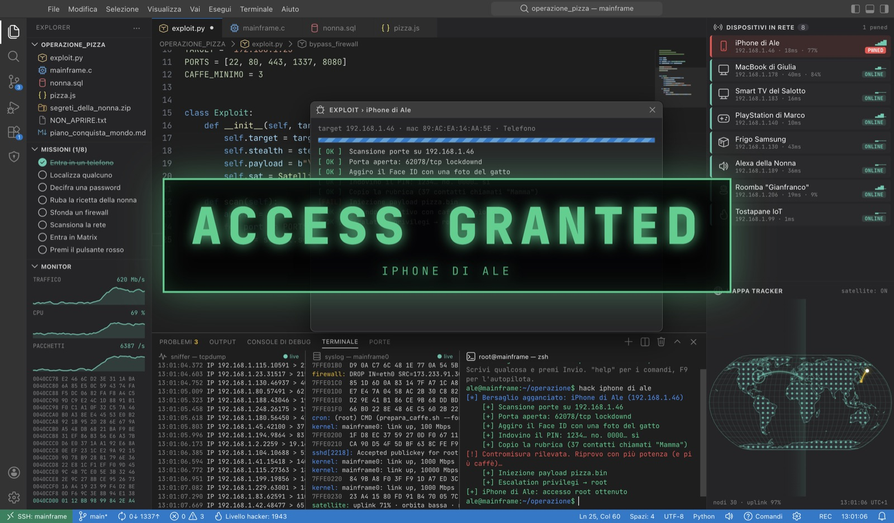
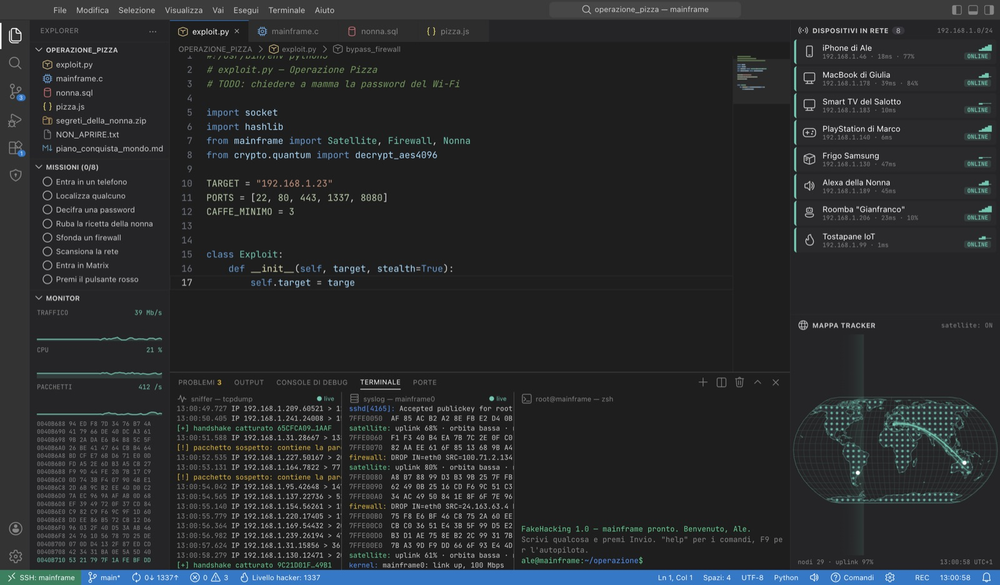
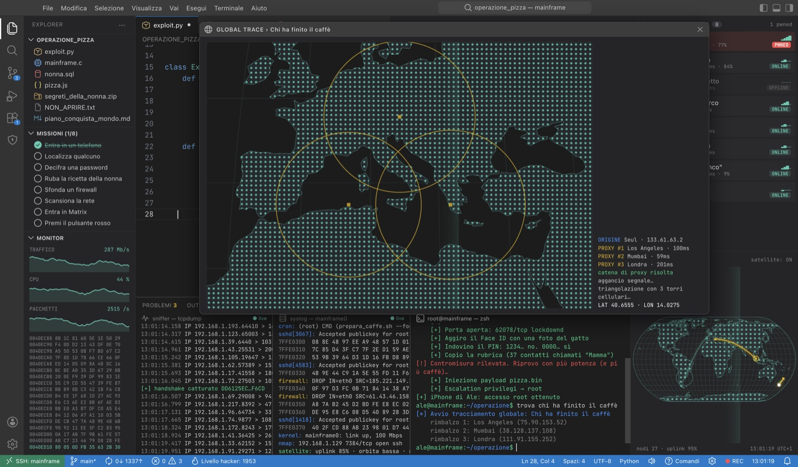
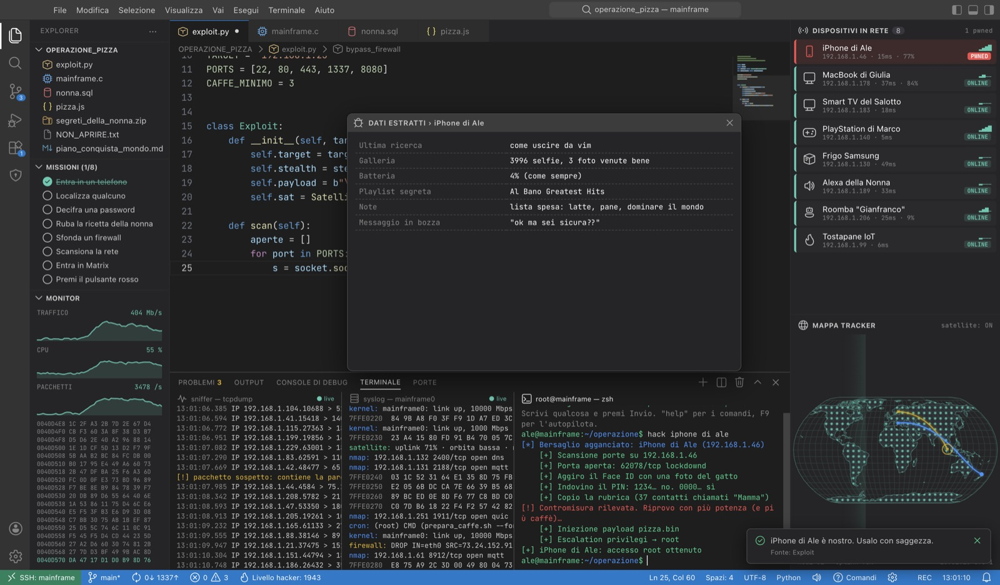
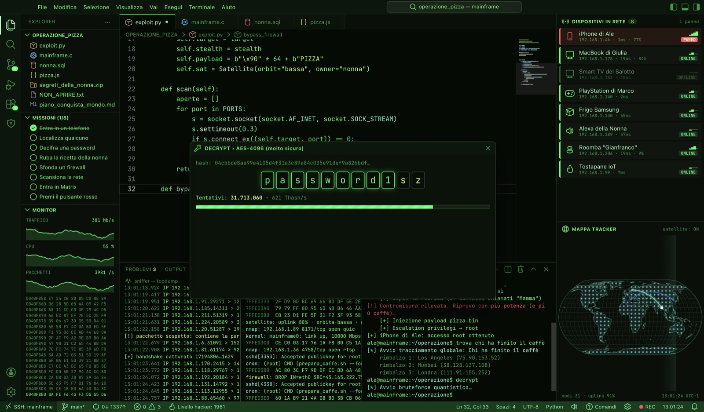
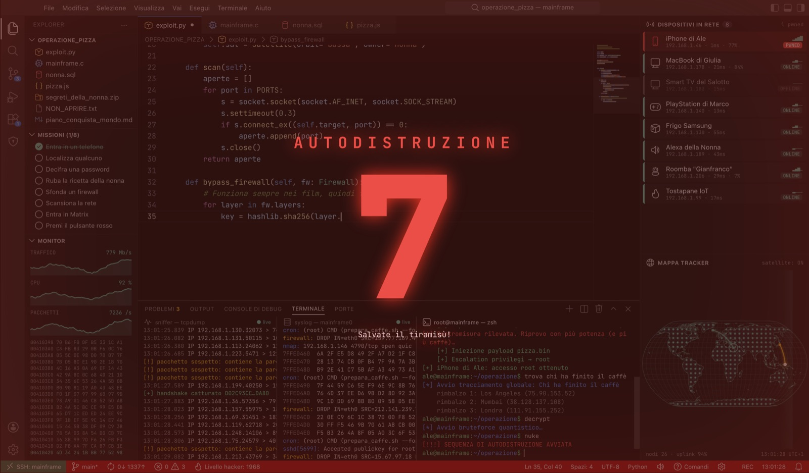

# FakeHacking

**La postazione hacker dei film, in stile VS Code.** Scrivi qualsiasi cosa, premi Invio e sembri un genio:
partono attacchi ai dispositivi, tracciamenti sulla mappa del mondo, password che si decifrano,
firewall che crollano e scritte giganti **ACCESS GRANTED**.

È tutto finto: l'app non usa la rete, non scansiona niente e non legge niente del tuo computer.
Serve per farsi due risate, fare scherzi agli amici o girare scene da film.



## Scarica

Vai su **[Releases](https://github.com/AlessandroLoVerso/FakeHacking/releases/latest)** e scegli il file giusto.
Una volta installata, l'app si chiama **Hacking**: a schermo non compare mai la parola "fake", così la scena regge.

| Sistema | File |
|---|---|
| Mac con chip Apple (M1, M2, M3, M4…) | `Hacking-…-mac-arm64.dmg` |
| Mac con Intel | `Hacking-…-mac-x64.dmg` |
| Windows, senza installare niente | `Hacking-…-windows-portable.exe` |
| Windows, con installazione | `Hacking-…-windows-setup.exe` |

**Primo avvio su Mac.** L'app non è firmata da Apple (costa 99 $ l'anno). Trascinala in Applicazioni.
Se macOS dice che è danneggiata o che lo sviluppatore non è identificato, apri il Terminale e lancia:

```bash
xattr -cr /Applications/Hacking.app
```

Poi aprila normalmente.

**Primo avvio su Windows.** Se compare "Windows ha protetto il PC", clicca *Ulteriori informazioni* e poi *Esegui comunque*.

## Come si usa

1. Apri l'app e premi **F11** per lo schermo intero.
2. Scrivi nella console in basso a destra, anche frasi a caso, e premi **Invio**.
3. Clicca un dispositivo nella colonna destra per "hackerarlo".
4. Premi **Ctrl+E** (o clicca l'editor) per la modalità *hackertyper*: ogni tasto scrive codice credibile.

### Comandi della console

I comandi funzionano anche dentro le frasi, per esempio *"ok adesso hackera il frigo"* o *"trova chi ha finito il caffè"*.

| Scrivi | Cosa succede |
|---|---|
| il nome di un dispositivo, oppure `hack` | Attacco al dispositivo, ACCESS GRANTED, scheda **PWNED** e dati "rubati" assurdi |
| `trace`, `trova`, `localizza` | Rimbalzi tra proxy nel mondo, zoom sull'Italia, triangolazione e indirizzo del bersaglio |
| `decrypt`, `password`, `decifra` | Password che si decifra lettera per lettera |
| `download`, `scarica`, `ruba` | Download segretissimi a velocità impossibili |
| `firewall`, `bypass` | Muri di difesa che crollano uno alla volta |
| `scan`, `nmap` | Radar della rete e nuovi dispositivi scoperti |
| `matrix` | Pioggia di caratteri a tutto schermo |
| `nuke`, `autodistruzione` | Allarme rosso e conto alla rovescia… |
| `help` | Elenco dei comandi |
| `whoami`, `ls`, `sudo`, `caffè`, `clear` | Piccole sorprese |
| testo senza senso | Diventa un "exploit personalizzato" e parte una scena a caso |

### Tasti da regista

| Tasto | Effetto |
|---|---|
| **F1** / Alt+1 | ACCESS GRANTED gigante |
| **F2** / Alt+2 | ACCESS DENIED gigante |
| **F3** / Alt+3 | Tracciamento sulla mappa |
| **F4** / Alt+4 | Allarme rosso |
| **F5** / Alt+5 | Matrix |
| **F6** / Alt+6 | Attacco a un dispositivo a caso |
| **F7** / Alt+7 | Decifra password |
| **F8** / Alt+8 | Download segreto |
| **F9** / Alt+9 | **Autopilota**: l'app scrive e lancia comandi da sola, per girare video senza mani |
| **F10** / Alt+0 | Autodistruzione |
| **Ctrl+B** | Tasto capo: compare un noiosissimo foglio di calcolo. Ripremi per tornare |
| **Ctrl+,** | Impostazioni |
| **Ctrl+\`** · **Ctrl+E** | Vai alla console · vai all'editor |
| **Alt+M** | Suoni on/off |
| **F11** | Schermo intero |
| **Esc** | Chiude finestre ed effetti |

Sui Mac portatili i tasti F potrebbero richiedere **fn** (fn+F1…): in alternativa usa **Option+1…0**.

### Impostazioni

Con **Ctrl+,** (o l'ingranaggio in basso a sinistra) puoi:

- cambiare il tuo nome da hacker;
- **mettere i nomi dei tuoi amici** nella lista dei dispositivi (es. "Telefono di Marco"), così in console puoi scrivere `hack telefono di marco`;
- scegliere il tema: Scuro stile VS Code, **Verde hacker** o **Allarme rosso**;
- regolare velocità di scrittura, suoni, effetto vecchio monitor (CRT), sequenza di avvio e notifiche buffe.

Le impostazioni restano salvate anche dopo la chiusura.

### Missioni

Nella barra laterale ci sono 8 missioni (entrare in un telefono, localizzare qualcuno, entrare in Matrix…).
Completale tutte per una sorpresa finale.

## Galleria

| | |
|---|---|
|  |  |
|  |  |



## Per sviluppatori

Serve Node.js 22 o più recente.

```bash
npm install
```

```bash
npm run dev
```

| Comando | A cosa serve |
|---|---|
| `npm run dev` | Avvia l'app Electron con ricaricamento automatico |
| `npm run dev:web` | Solo l'interfaccia nel browser, su http://localhost:5173 |
| `npm test` | Test del parser dei comandi e delle impostazioni |
| `npm run build` | Controllo dei tipi e build dell'interfaccia |
| `npm run dist:mac` / `npm run dist:win` | Crea il .dmg o gli .exe in `release/` |

Struttura:

```
electron/main.cjs    finestra Electron (niente rete, niente Node nella pagina)
src/core/            impostazioni, suoni sintetizzati, eventi, utilità
src/data/            codice finto, dispositivi, città, battute
src/engine/          parser dei comandi, scene da film, autopilota, missioni
src/ui/              layout VS Code, editor, terminali, dispositivi, mappa, effetti
tests/               test con Vitest
```

**Pubblicare una nuova versione.** Aggiorna `version` in `package.json`, poi crea e invia il tag:

```bash
git tag v1.0.1
```

```bash
git push origin v1.0.1
```

GitHub Actions costruisce le app per Mac e Windows e crea la Release con i file da scaricare.

**Nota per Mac con iCloud.** Se il progetto sta in una cartella sincronizzata con iCloud (Documenti, Scrivania),
la firma ad-hoc del `.dmg` locale può fallire per i metadati che iCloud aggiunge ai file. Le build su GitHub non hanno questo problema.

## Crediti

- Font [JetBrains Mono](https://www.jetbrains.com/lp/mono/) (SIL Open Font License 1.1)
- Icone [Codicons](https://github.com/microsoft/vscode-codicons) di Microsoft (CC BY 4.0)
- Confini del mondo da [Natural Earth](https://www.naturalearthdata.com/) (pubblico dominio) tramite [world-atlas](https://github.com/topojson/world-atlas)
- [d3-geo](https://github.com/d3/d3-geo) e [topojson-client](https://github.com/topojson/topojson-client) (ISC)

FakeHacking non è affiliato a Microsoft né a Visual Studio Code: ne imita solo lo stile.
I nomi dei dispositivi sono inventati e modificabili.

## Licenza

[MIT](LICENSE)
